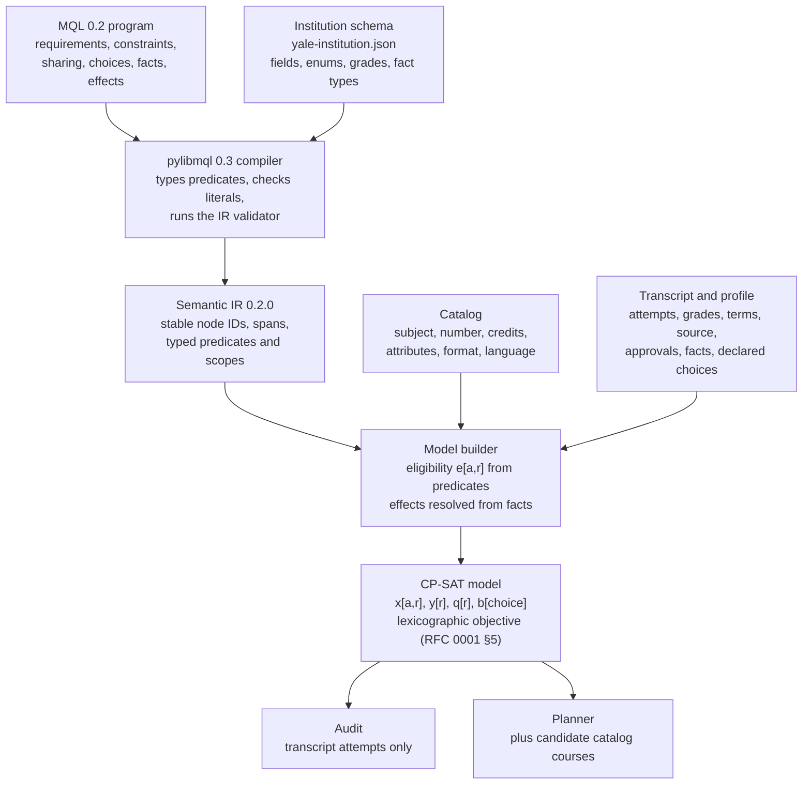

# MQL for CP-SAT Auditing and Planning

As of 2026-10-28, with MQL 0.2 (pylibmql 0.3.0, IR schema 0.2.0).

The previous version of this report found that MQL 0.1 could describe which courses fill a slot, but not how courses are shared, credit totals, caps, grouping, branches, or transcript facts. It proposed ten extensions. MQL 0.2 includes all ten, with semantics fixed by RFC 0001 and syntax by RFC 0002. All 189 programs for the 2026–27 Yale catalog are now written in MQL 0.2. Each compiles against a Yale institution schema and validates against `mql-ir-0.2.schema.json`.

The remaining work is mostly outside the language: an engine that builds and solves the CP-SAT model, the catalog and transcript data the predicates read, and module support so that near-duplicate programs can share one definition.

## Architecture

The compiler turns each program into the semantic IR once. An engine combines the IR with the institution schema, catalog, transcript, and profile into a single CP-SAT model. Audit and planning use the same model and differ only in which courses enter it and in the objective.

Predicates are evaluated outside the solver, so the solver sees only Boolean eligibility `e[a,r]` for each attempt and requirement. The rest of the IR (contributions, bounds, activation, constraints, sharing, and choices) maps to linear constraints.

## Core CP-SAT model

**Sets**

- Attempts `a`: transcript attempts for an audit; transcript attempts plus candidate offerings for planning. Repeated courses are distinct attempts.
- Requirements `r`: every IR requirement node at every depth.
- Choices `c` with alternatives `v`; facts `f` (inputs).

**Variables**

| Variable | Domain | Meaning |
| --- | --- | --- |
| `x[a,r]` | bool, created only where `e[a,r]` | attempt `a` is assigned to requirement `r` |
| `act[r]` | bool | `r` is active (a fixed constant when its condition uses only facts and declared choices) |
| `b[c,v]` | bool | choice `c` takes value `v` (fixed for `declared` choices) |
| `q[r]` | int | contribution of `r` in its unit |
| `y[r]` | bool | `r` is satisfied |
| `u[a]` | bool | `a` is used anywhere in the program |
| `z[a]` | bool, planning only | candidate `a` is added to the plan |

**Constraints from the IR**

| IR construct | CP-SAT encoding |
| --- | --- |
| choice | `sum_v b[c,v] = 1`; declared choices fixed from the profile, solver choices free |
| `active_when` | `act[r] <=> condition(b, facts)`; descendants `act[child] => act[parent]` |
| inactive node | `x[a,r] = 0`, `q[r] = 0`, `y[r] = 0` when `!act[r]` |
| `SLOT` | `q[r] = sum_a x[a,r] <= 1` |
| `DISTINCT_ATTEMPTS` | `q[r] = sum_a x[a,r]` |
| `DISTINCT_CANONICAL_COURSES` | `q[r] = sum_k OR_{a in k} x[a,r]` over canonical courses `k` |
| `CREDITS` | `q[r] = sum_a units(a) * x[a,r]`, using the fixed value when `each n credits` is given |
| `NESTED_SATISFACTION` | `q[r] = sum_child y[child]` |
| bounds | `y[r] <=> act[r] and q[r] >= lower`; `q[r] <= upper`; `CHOICE_TABLE` bounds become `b[c,v] => (lower = n_v)` |
| default exclusivity | `sum_r x[a,r] <= 1` over the named requirements that are not linked by a `share` rule |
| `share a, b, c` | the pairwise exclusivity rows for those pairs are dropped; `x[a,r] <= 1` still holds per requirement |
| `SELECTED_SET` | `sum_{a in scope, p(a)} x[a,·] (>=, <=, =) n`; `ALL` forbids `x` for non-matching attempts in scope |
| `LIMIT` | `sum_{a in scope, p(a)} u_scope[a] * w(a) <= n` |
| `TOTAL` | `sum_{a in scope} u_scope[a] * w(a) >= n`, counting a shared attempt once |
| `GROUP` | one Boolean per group value; `DISTINCT_AT_LEAST`: `sum g >= n`; `SAME`: exactly one `g`, and `x => g(attr(a))`; per-group caps sum over each value |
| `REPEAT` | `sum_{a of course k} u_scope[a] <= n` for each matching canonical course `k` |
| `ORDERING` | audit: precomputed from terms; planning: `t[a1] < t[a2]` |
| effects | evaluated from the original state before solving: `WAIVE` sets `y[r] = 1` with a fact witness, `REPLACE_BOUND` rewrites a bound, `SET_ACTIVE` fixes `act`, `PERMIT_ASSIGNMENT` adds eligibility |

**Objective** (RFC 0001 §5, lexicographic, solved in stages or with exact weights)

1. Maximize the number of satisfied active required roots.
2. Maximize the exact sum of `min(q, lower) / lower` over unsatisfied active required roots. The denominators are known, so scaling by their least common multiple keeps the objective in integers.
3. Prefer assignments witnessed by course attempts over those witnessed only by approvals.
4. Planning only: minimize added courses `sum z[a]`, then credits, then terms.

Priority no longer exists. Advisory requirements receive no variables.

## Requirement patterns across the 82 majors

The twenty patterns from the previous report each map to one or more 0.2 constructs. The counts are the number of the 189 programs whose compiled IR uses the construct.

| # | Pattern | Example | 0.2 construct | Programs | Status |
| --- | --- | --- | --- | --- | --- |
| P1 | Choose n from a fixed list | CPSC 3650 or 3660 | `slot from [...]`, `courses exactly n from [...]` | 183 | Supported |
| P2 | n courses from an open pool | 4 ECON electives 2000+ | `courses at least n where course.subject = "ECON" and course.number >= 2000` | 173 | Supported |
| P3 | Nested alternative sequences | PHYS 1800–1810 or 2000–2010 | `children at least 1` with nested requirements | 142 | Supported |
| P4 | Credit totals | Chemistry: 4 credits of advanced work; MechE 19.5 credits | `credits at least n`; `total at least n credits` | 56 | Supported |
| P5 | Caps, scoped | at most 2 outside courses; only one of 3650/3660 | `limit n attempts where … in <scope>`; `group … at most n per group` | 119 | Supported |
| P6 | Distinct groups | three of seven electives in different departments (Archaeology) | `group course.subject distinct at least n` | 5 | Supported where the group is a course field; enumerated areas use `children at least k` |
| P7 | Same group | four courses in one African language | `group course.subject same`; area children | 6 | Supported, same caveat |
| P8 | Sharing between requirements | History region, preindustrial, and seminar | `share` rules; exclusive by default | 29 | Supported (see verbosity below) |
| P9 | Sub-conditions on the selected set | 3 of 4 EE electives at 4000+ | nested `at least m attempts where …` | 132 | Supported |
| P10 | Conditional counts | CS: one more elective if CPSC 3230 is taken | solver choice plus a choice-table bound or `when` branches | 13 | Supported |
| P11 | Program totals with overlap | Philosophy: 12 courses in all | `total at least n attempts in program` or `in roles [...]` | 187 | Supported |
| P12 | Exclusions | 2250–5999 excluding MATH 4700 | `not course.code in [...]` | 65 | Supported |
| P13 | Attribute predicates | Hu/So/Sc, L1–L5, YC attributes | `course.attributes contains`, `course.distributionals overlaps` | 102 | Supported (set literals checked by `validate.py`) |
| P14 | Transcript facts | letter grade only; senior year; PHYS 4010 before 4020 | `attempt.grading_mode`, `attempt.year_of_study`, `attempt.source`, `order … before …` | 189 | Supported |
| P15 | Repeat rules | PHYS 4710/4720 at most twice | `repeat at most n times where …` | 5 | Supported |
| P16 | Waivers and substitutions | AP Psychology 5 waives PSYC 1100; BIOL modules replaced by MCDB courses | `fact … : placement`, `effect … waive`, `set lower of`, `permit … where`, replacement requirements `when fact` | 102 | Supported |
| P17 | Requirement roles | prerequisites counted or not in totals | `[role]` lists and `in roles [...]` scopes | 147 | Supported |
| P18 | Track choice inside one program | French translation option; Film intensive | `choice … declared one of …` with `when` | 12 | Supported |
| P19 | Paired or fractional slots | MCDB 3420L+3430L as one elective | nested `courses exactly 2`, or `credits` pools | (in P3, P4) | Supported |
| P20 | Human approval | DUS-approved electives, areas of focus | `attempt.approved_for contains "<req>"`; `approval` facts with `waive` | 189 | Supported by convention (see below) |

### Corpus statistics

| Measure | Count |
| --- | --- |
| Programs | 189 (82 majors) |
| Requirement nodes (all depths) | 2,809 |
| by contribution | 1,333 `SLOT`, 989 `DISTINCT_ATTEMPTS`, 335 `NESTED_SATISFACTION`, 152 `CREDITS` |
| Constraints | 1,202: 706 `SELECTED_SET`, 234 `TOTAL`, 233 `LIMIT`, 16 `GROUP`, 8 `ORDERING`, 5 `REPEAT` |
| Sharing rules | 1,587 (1,496 in MB&B concentrations, 35 History of Art, 33 History, 16 Philosophy) |
| Effects | 204: 186 `WAIVE`, 16 `REPLACE_BOUND`, 2 `PERMIT_ASSIGNMENT` |
| Facts | 192 |
| Choices | 24 (13 declared tracks or concentrations, 11 solver choices) |
| Advisory requirements | 16 |
| `attempt.approved_for` references | 915 |
| `.mql` source lines | about 17,000 |

The 0.1 corpus used 889 `PLACEMENT` strings; none remain. Each became a typed fact, a requirement-level approval, or a predicate.

## How the encodings work

**Pools instead of repeated slots.** `courses at least 4 where …` is one requirement that accepts up to any number of distinct attempts. Identical repeated slots, which the previous report flagged as a source of solver symmetry, are gone.

**Prerequisites and totals.** Every program puts prerequisites in a `prerequisite` role. Totals that the catalog states "beyond the prerequisites" are scoped `in roles [core, elective, senior]`, and totals that include them are scoped `in program`.

**Approvals.** Most catalog judgments ("approved by the DUS", "in the area of focus", "or an equivalent") cannot be decided from catalog fields. They are written as `attempt.approved_for contains "<requirement id>"`, a set-valued transcript field the backend fills from adviser records. This keeps the approval tied to one attempt and one requirement, and the RFC objective ranks such assignments below ones that match on course data. Program-level sign-offs (orientations, prospectuses, admissions, field schools) use approval facts and `waive` effects, so the fact itself is the witness.

**Concentrations.** Where concentration rules are conditions on courses already counted for the major (Anthropology, Art), they are program-scope `SELECTED_SET` constraints and add no courses. Where concentration courses may also count toward major requirements (MB&B), they are separate requirements with `share` rules.

**Sharing verbosity.** A `share` rule permits every pair it lists, so allowing requirement C to share with A and with B, but not A with B, takes two rules. MB&B's concentrations need about 80 pairwise rules per program for this reason. A scope-based form such as `share conc_x with roles [core, elective]` would cut this to one line per concentration requirement without changing the IR's meaning.

## Planner: courses that would fulfil a requirement

The three-step approach from the previous report still applies, now driven by the IR.

1. **Static match.** For requirement R, every catalog course whose predicate or list makes `e[a,R]` true. This is a database query over the institution fields, with no solver.
2. **Useful match.** Fix the baseline audit's objective values (RFC 0001 §15 fixes values, not a particular assignment), add one candidate with `z[a]` as an assumption, and ask whether R's satisfaction or exact progress improves. The answer per course is that it counts directly, counts after reassignment, or is blocked; blocked answers name the constraint or sharing rule by its IR node ID and source span.
3. **Completion plan.** Add all candidates as optional, minimize `sum z[a]` (then credits) subject to completion, and enumerate equal-cost alternatives for R. Terms add `t[a]`, offering data, prerequisite edges, `ORDERING` constraints, and per-term caps.

Facts and approvals are never planned as courses. The planner lists them as actions: "submit AP score", "get DUS approval for this course toward `electives`", "complete the library orientation".

## Data the backend must supply

Each field the programs use is declared in `majors/2627/yale-institution.json`. Without these fields the predicates cannot be evaluated.

| Record | Field | Used by |
| --- | --- | --- |
| Catalog course | `subject`, `number`, `code` (canonical, with cross-listings) | lists, ranges, exclusions |
| Catalog course | `credits` | `credits` counts, credit totals |
| Catalog course | `attributes` (exact Yale Course Search strings) | 102 programs |
| Catalog course | `distributionals` | language and area rules |
| Catalog course | `format` (lecture, seminar, lab, studio, independent study, research, senior project, language, …) | seminar and lab rules |
| Catalog course | `language` of instruction | French, Italian, Spanish, Comparative Literature, Latin American Studies |
| Transcript attempt | `grade`, `grading_mode`, `graduate_grade` | letter-grade, Credit/D/Fail, and graduate rules |
| Transcript attempt | `source`, `enrolled_subject`, `term`, `year_of_study` | outside credit, "enrolled under HIST", ordering, senior-year rules |
| Transcript attempt | `approved_for` | 189 programs |
| Student profile | declared choices, facts (placements, proficiencies, approvals) | tracks, waivers, admissions |

`format`, `language`, and `year_of_study` are not in Yale Course Search exports today and must be derived, either from section types and term-of-enrollment data or by hand for the courses the programs name.

## Resolved questions from the previous report

- [x] **Slot or filter?** Both, explicitly: `slot` fills once; `courses`/`credits` pools fill many (RFC 0001 §6).
- [x] **Default sharing?** Exclusive across named requirements, with `share` rules as exceptions (§11).
- [x] **Priority?** Removed. The objective is fixed and priority is display-only (§5).
- [x] **Upper bounds?** They cap assignments; extra courses never cause failure (§5).
- [x] **Unscoped `LIMIT`?** Invalid. Every top-level constraint declares a scope (§10, RFC 0002 `MQL0309`).
- [x] **Credit units?** Integers at a declared `credit_scale`; all programs use 2 (§2).
- [x] **Fact names validated?** Yes, against the institution schema's fact types (`MQL0308`).
- [ ] **Composition by import?** Deferred to a later RFC (§17). MB&B (21 programs) and MCDB (16) are generated from one template each in the meantime.

## Open questions for the MQL team

- [ ] Are predicate literals on `CREDIT` fields compared in credits or in scaled units? Until this is specified, the programs avoid `course.credits` comparisons.
- [ ] Should the compiler check `SET` literals (attributes, distributionals) against schema value lists, the way it checks enum members? `validate.py` does this today.
- [ ] Can `group` constraints take a predicate (for example, "no more than two introductory courses per department")? Sociology works around this with one `limit` per subject.
- [ ] Can category coverage over a selected set ("four of five geographic categories among the six upper-level courses") become one constraint over a set-valued field? History of Art uses ten requirements and 35 pairwise `share` rules.
- [ ] A scope-based `share` form (`share r with roles [...]`) would replace about 1,500 pairwise rules.
- [ ] Is `attempt.approved_for` an acceptable way to carry course-level approvals, or should RFC 0001 §13 approvals gain an attempt target so that the witness is a fact?
- [ ] Computed rules such as grade averages ("all graduate grades average High Pass") have no IR form and are advisory for now.
