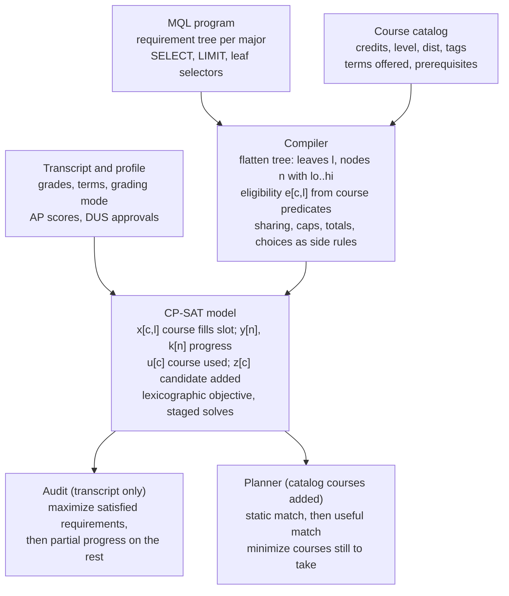

# MQL for CP-SAT Auditing and Planning

As of 2026-10-28.

Both features reduce to one CP-SAT model: assign courses to requirement slots, with side constraints. Today MQL describes only which courses may fill a slot. To cover every requirement in the 2026–27 Yale majors, the language must also state how courses may be shared between requirements, credit totals, caps, grouping rules, conditional branches, and transcript facts such as grades, terms and waivers.

## Architecture

The backend compiles each MQL program once into a solver model. The audit and the planner differ only in which courses enter it and in the objective.



Course matching is computed outside the solver from catalog fields, so the solver sees only booleans `e[c,l]`. Everything else in the language must arrive as explicit side rules.

## Core CP-SAT model

An audit is a maximum-satisfaction assignment of transcript courses to requirement slots. Every MQL construct below must compile to integer linear constraints over these variables, so each one needs an unambiguous counting rule.

**Sets**

- Courses `c`: transcript courses for an audit; transcript plus candidate catalog courses for planning.
- Leaves `l`: every leaf selector in the compiled tree (`CLASS`, `RANGE`, `TAG`, `DIST`, `PLACEMENT`, …); each is a slot.
- Nodes `n`: every `SELECT`, top-level or nested, with quantity bounds `lo..hi`.
- Eligibility `e[c,l]`: a precomputed boolean, true when course `c` matches leaf `l`. It is a pure function of the course record, computed outside the solver.

**Variables**

| Variable | Domain | Meaning |
| --- | --- | --- |
| `x[c,l]` | bool, created only where `e[c,l]` | course `c` fills slot `l` |
| `y[n]` | bool | node `n` is satisfied |
| `k[n]` | int 0..children | number of satisfied children of `n` (progress) |
| `u[c]` | bool | course `c` is used anywhere in the program |
| `z[c]` | bool, planning only | candidate course `c` is added to the plan |
| `t[c]` | int, planning only | term in which `c` is taken |

**Constraints**

1. Slot capacity: `sum_c x[c,l] <= 1` for every leaf. One slot, one course. This is the spec's §5.2 reading; the alternative "one `RANGE` fills many slots" needs a separate capacity per leaf (pattern P2).
2. Node counting: `k[n] = sum(leaf children filled) + sum(y[child] for nested children)`; `y[n] => lo <= k[n] <= hi`. A nested `SELECT` contributes 1, never its own quantity.
3. Course reuse: `sum_l x[c,l] <= cap(c)`. With no sharing rules `cap = 1`; sharing rules (P8) replace this with per-pair permissions.
4. Usage link: `u[c] = OR_l x[c,l]`, used by totals (P11) and caps (P5).
5. `LIMIT`: `sum_{c matching} u[c] <= k`, or over `x` inside a scope (P5).
6. Planning only: `x[c,l] => z[c]` for catalog courses; transcript courses have `z` fixed true.

**Objective** (lexicographic, solved in stages or with weights)

1. Maximize satisfied top-level requirements, `sum y[root]`.
2. Maximize progress `sum k[n]` on the unsatisfied ones, so the audit shows partial credit.
3. Minimize `PLACEMENT` slots filled by manual override, so real courses are preferred.
4. Planning: minimize `sum z[c]` (courses still to take), then credits, then terms.

The `priority` field has no defined meaning today. Either drop it or define it as the stage order in step 1 (lower number solved first, then fixed).

## Requirement patterns across the 82 majors

Twenty patterns cover every requirement in the 2026–27 catalog. MQL handles three cleanly, three partially, eight only through workarounds, and six not at all. The workarounds (repeated selectors, duplicated branches, comments, `PLACEMENT` strings) compile to models that are wrong or unsolvable, so every row marked Gap or Workaround needs a language change.

| # | Pattern | Example from the catalog | MQL today | CP-SAT constraint needed |
| --- | --- | --- | --- | --- |
| P1 | Choose n from a fixed list | CPSC 3650 or 3660; 3 of ART 1732, 2764, 2765 | Supported | `sum x >= n` over the listed leaves |
| P2 | n courses from an open pool | 4 ECON electives numbered 2000+; 6 GMAN 1600+ | Workaround: repeat `RANGE` n times | one pool leaf with capacity n: `sum_c x[c,l] <= n`, counted by course |
| P3 | Nested alternative sequences | PHYS 1800+1810 or 2000+2010; EECS senior: CPSC 4900, or ECE 4710 and/or 4721 | Supported if a nested `SELECT` counts as 1 | `y[child]` as one unit in the parent sum |
| P4 | Credit totals, not course counts | Chemistry: 4 credits of advanced work where 4000+ lectures are 0.5; MechE 19.5 credits; MCDB 4950 = 2 credits; Urban Labs 1.5 | Gap (approximated with `SELECT 4-8`) | `sum cred[c]*x >= 2*n` in half-credit integers |
| P5 | Caps, scoped | at most 2 outside courses (Economics, English); only one of CPSC 3650/3660; at most 2 per department (EEB prerequisites); at most 3 credits of PSYC 4900–4999 | `LIMIT` exists, scope undefined | `sum u[c] <= k` over a declared scope (requirement, program, or per group) |
| P6 | Distinct groups | 3 breadth areas (Applied Math); 3 of 5 periods (Comp Lit); 3 of 7 electives in different departments (Archaeology) | Workaround when groups are enumerable; gap for "different departments" | bool per group `g`, `sum g >= k`, each course credits one group |
| P7 | Same group | 3 concentration courses from one breadth area (Applied Math); 4 courses in one African language; 5 credits in one History region or pathway; in-language literature in a single language (Comp Lit) | Workaround: one branch per group | choose exactly one group `g`; `x[c,l] => attr(c) == g` |
| P8 | Sharing between requirements | History: one course may count for region, preindustrial and seminar; Cognitive Science: no course fulfils two requirements; MCDB: a course cannot count as prerequisite and core; MB&B concentration courses may also count for the major | Gap (comments only) | per requirement-pair permission: `x[c,l1] + x[c,l2] <= 1` unless shared |
| P9 | Sub-conditions on the selected set | at least 3 of 4 EE electives at 4000+; 5 of 8 ITAL courses taught in Italian; at least 1 of 4 EPS electives from EPS; at least 1 elective a lecture or seminar | Workaround: a second requirement re-lists the pool, not tied to the same courses | `sum_{c in R, matches} x >= m` inside requirement R |
| P10 | Conditional counts | CS: 6 electives if CPSC 3230 replaces 3231+3232; Econ & Math: 2 or 3 math electives depending on the senior seminar; one- vs two-term senior essays changing totals (History, EALL, Urban Studies) | Workaround: duplicate whole branches | choice bool `b`; constraints with `OnlyEnforceIf(b)` |
| P11 | Program totals with overlap | Philosophy: 12 courses in all; English Creative Writing: at least 11 literature courses; Econ & Math: 7 ECON + 5 MATH | Gap (approximated by an extra requirement) | `sum_c u[c]*w[c] >= n` over courses used by named requirements |
| P12 | Exclusions | 2250–5999 excluding MATH 4700; any PHIL except 1115; CPSC 4900 not an elective; research courses only for the senior requirement (MCDB) | Workaround: split ranges | eligibility `e[c,l] = false` |
| P13 | Attribute predicates | Hu/So/Sc/QR/WR, L1–L5; YC attributes; taught in English; seminar vs lecture; SC courses numbered 2000+ in any department (EVST B.S.) | Partial: `DIST`, `TAG`, `RANGE_*`, one attribute at a time | eligibility from a boolean predicate over course fields |
| P14 | Transcript facts | letter grade only; at most 1 or 2 Credit/D/Fail; grade B or above; taken in senior year; PHYS 4010 before 4020; at most 4 study-abroad credits (French, Global Affairs) | Gap | eligibility over transcript rows; caps over flags; `t[c1] < t[c2]` in planning |
| P15 | Repeat rules | CHEM 4900 twice; PHYS 4710/4720 in any combination twice; only one term of CGSC 4710–4740 counts; RUSS 4900 or 4910, not both | Workaround: list the class twice | per-course `cap(c)` from a repeat rule; transcript rows as distinct `c` |
| P16 | Waivers and substitutions | AP 5 in Psychology replaces PSYC 1100; BIOL modules placed out, every two replaced by one MCDB core; language proficiency without coursework means extra electives (Russian, REEES) | Gap: opaque `PLACEMENT` strings | named boolean facts from the student profile, with a substitution rule |
| P17 | Requirement roles | prerequisites counted in totals (Architecture, Art) or not (Psychology, Econ & Math); senior requirement; concentration courses | Gap | role tag on each requirement, used by P8 and P11 |
| P18 | Track choice inside one program | HSHM concentration; History specialist region; French translation option; Math intensive as B.A. or B.S. | Workaround: large alternative `SELECT` | exactly-one over track bools, enforcement literals |
| P19 | Paired or fractional slots | MCDB 3420L+3430L count as one elective; Art paired labs | Supported via nested `SELECT 2` | nested node as one unit |
| P20 | Human approval | DUS-approved electives, area-of-focus courses, Special Divisional Major | `PLACEMENT` | override bool set by an adviser; penalized in the objective |

In the 189 programs written for this catalog, P2 (open pools) and P14 (a Credit/D/Fail rule) appear on almost every major's page, and most majors also need P8 or P9.

## Proposed language extensions

Ten additions close every gap in the pattern table, and each has a direct CP-SAT encoding. The syntax below is a sketch for the MQL team to refine, not a fixed grammar.

| Extension | Sketch | Closes | Compiles to |
| --- | --- | --- | --- |
| Course-counted pools | `SELECT 4 COURSES FROM RANGE(ECON 2000, ECON 9999)` | P2 | one leaf, capacity 4 |
| Credit quantities | `SELECT 4 CREDITS FROM $advanced` | P4 | weighted sum in half-credit units |
| Predicates and set difference | `WHERE level >= 2000 AND dist = "SC" AND NOT seminar`, `EXCEPT [MATH 4700]` | P12, P13 | eligibility filter |
| Constraints on the chosen set | `SELECT 4 FROM $el HAVING AT LEAST 3 WHERE level >= 4000` | P9 | count over the same `x` |
| Group rules | `DISTINCT dept >= 3`, `SAME language`, `MAX 2 PER dept` | P5, P6, P7 | group bools, exactly-one, per-group caps |
| Scoped `LIMIT` | `LIMIT 2 COURSES FROM $outside IN PROGRAM` vs `IN "Electives"` | P5 | cap over `u` or over one requirement's `x` |
| Named requirements and sharing | `REQ hist_pre = SELECT …;` then `SHARE hist_pre, region, seminar;` or `EXCLUSIVE ALL` | P8, P17 | pairwise exclusivity except declared shares |
| Program totals and roles | `ROLE prereq;` on a requirement; `TOTAL 12 COURSES FROM ROLE core, elective, senior` | P11, P17 | sum of `u` over the named requirements |
| Choices and conditions | `CHOOSE senior IN {one_term, two_term};` then `IF senior = one_term THEN SELECT 6 … ELSE SELECT 5 …` | P10, P18 | exactly-one bools, `OnlyEnforceIf` |
| Facts, transcript rules, repeats | `FACT("ap_psych_5")`, `WHERE grade >= "B"`, `WHERE grading = "letter"`, `LIMIT 1 COURSES WHERE grading = "CR/D/F"`, `REPEATABLE 2 [PHYS 4710, PHYS 4720]`, `BEFORE(PHYS 4010, PHYS 4020)` | P14, P15, P16 | eligibility over transcript rows, caps, term ordering |

Three rewrites show the difference.

EE B.S. electives today repeat a selector list and restate the pool in a second, unlinked requirement:

```
SELECT 4 FROM [$elective, $elective, $elective, $elective] : "Four engineering electives";
SELECT 3 FROM [$elective4, $elective4, $elective4] : "At least three at the 4000 level";
```

With the extensions, one requirement carries both rules over the same four courses:

```
SELECT 4 COURSES FROM $elective
  HAVING AT LEAST 3 WHERE level >= 4000
  : "Four engineering electives, three at 4000+";
```

Computer Science duplicates a branch to say "an extra elective if CPSC 3230 replaces 3231 and 3232":

```
CHOOSE systems IN {split, combined};
IF systems = split THEN SELECT 2 FROM [CPSC 3231, CPSC 3232] ELSE SELECT 1 FROM CPSC 3230 : "Systems";
SELECT (IF systems = split THEN 5 ELSE 6) COURSES FROM TAG("YC CPSC Elective") : "Electives";
```

History states which requirements may share a course, and the twelve-credit total that overlap makes necessary:

```
REQ regions = SELECT 5 FROM [SELECT 1 FROM TAG("YC HIST Africa"), …] : "Five of six regions";
REQ preind = SELECT 2 COURSES FROM TAG("YC HIST Preindustrial") : "Two preindustrial";
REQ seminars = SELECT 2 COURSES FROM RANGE_TAG(HIST 3000, HIST 3999, "YC HIST Departmental Seminars") : "Two seminars";
SHARE regions, preind, seminars;
TOTAL 12 CREDITS FROM ALL : "Twelve course credits";
```

One semantic decision must come before any syntax: whether a leaf is a slot (fills once) or a filter (fills many). This report assumes slots plus explicit `COURSES` pools, which keeps today's files valid.

## Planner: courses that would fulfil a requirement

Listing candidates takes three steps, from cheap to exact. Only the last two need the solver, and they run per candidate with assumptions rather than one model per course.

1. **Static match.** For requirement R, every catalog course with `e[c,l]` true for some leaf under R. This is a database query, needs no solver, and is correct whenever the predicates (P12, P13) are expressible. It over-reports: a course may match but be unusable.
2. **Useful match.** Fix the student's current best audit, add one optional catalog course `c` with `z[c]` as an assumption, and ask whether `k[R]` rises without lowering any satisfied requirement. CP-SAT assumption solving reuses one model across candidates; hint it with the current audit. This removes courses blocked by sharing rules (P8), caps (P5), repeat rules (P15) and same-group choices (P7). The answer per course: counts / counts only if moved from another slot / does not count, with the blocking rule named.
3. **Completion plan.** Add all candidates as optional, minimize `sum z[c]` (then credits) subject to every requirement being satisfied. Return the plan and, for R, the alternative courses at equal cost, enumerated with a solution limit. With terms, add `t[c]`, offering data, prerequisite edges as `t[pre] < t[c]`, and a per-term credit cap.

Size: a Yale transcript has about 36 courses, a program tens to a few hundred leaves (Applied Mathematics lists over 100 courses), and the catalog several thousand courses. Step 1 prunes candidates to the few hundred that match any leaf, which should keep steps 2 and 3 to seconds. Identical repeated slots should get symmetry-breaking order constraints (`x` lexicographic by course id) or be replaced by `COURSES` pools, which remove the symmetry entirely.

`PLACEMENT` and `FACT` leaves are never planned courses: the planner lists them as actions ("get DUS approval", "submit AP score") rather than courses.

## Data the backend must supply

Every predicate the language gains needs a field behind it; without these, eligibility `e[c,l]` cannot be computed and the extensions are inert.

| Record | Field | Used by |
| --- | --- | --- |
| Catalog course | subject code, number, lab suffix | `CLASS`, `RANGE` |
| Catalog course | all cross-listed and renamed codes (e.g. BLST/AFAM, CPLT/LITR, HELN/MGRK, EENG/ECE) | matching cross-listed codes |
| Catalog course | credits (0.5, 1, 1.5, 2) | P4, P11 |
| Catalog course | level (from number), format (lecture, seminar, lab, independent study, research) | P9, P13 |
| Catalog course | distributional designations (Hu, So, Sc, QR, WR, L1–L5) | `DIST` |
| Catalog course | YC attributes, as exact strings from the attributes index | `TAG` |
| Catalog course | language of instruction | French, Italian, Spanish rules |
| Catalog course | terms offered, prerequisites | planner terms and ordering |
| Transcript row | course, term, grade, grading mode (letter, CR/D/F, P/F) | P14 |
| Transcript row | source (Yale, study abroad, summer, transfer), enrolled-under code | P14, History's "enrolled under HIST" |
| Student profile | class year, declared program and track, AP/IB scores, placement results, DUS approvals | P16, P18, P20 |

`TAG` strings must match the attributes index exactly, and several are truncated there ("YC ARCH Urbanism & Landscap"). The MQL team should publish the canonical list with the parser and validate `TAG` arguments against it, as `CLASS` department codes are already validated.

## Open questions for the MQL team

- [ ] Is a leaf a slot or a filter? The spec's §5.2 example implies a slot; many older files in the repository assumed a filter. Pick one and add `COURSES` for the other.
- [ ] Default sharing: are courses exclusive across requirements unless `SHARE` says otherwise? Yale's pages mostly imply exclusive, with explicit exceptions (History, Anthropology concentrations, MB&B).
- [ ] What does `priority` mean: solve order, objective weight, or display hint only?
- [ ] Does an upper bound in `SELECT n-k` cap what counts (extra courses spill to other requirements) or reject the assignment?
- [ ] Should a `LIMIT` with no scope apply to the whole program? Today it is written as its own top-level requirement, which reads as "satisfied when at most k" and is trivially true when nothing matches.
- [ ] How are credit units represented: half-credit integers, or a decimal type in the grammar?
- [ ] Should programs that share most rules (MB&B and MCDB degrees × concentrations, Sociology tracks) compose by `IMPORT` of a base program instead of 21 near-copies?
- [ ] Which transcript facts can the parser assume exist, so `FACT(...)` names are validated like department codes?
